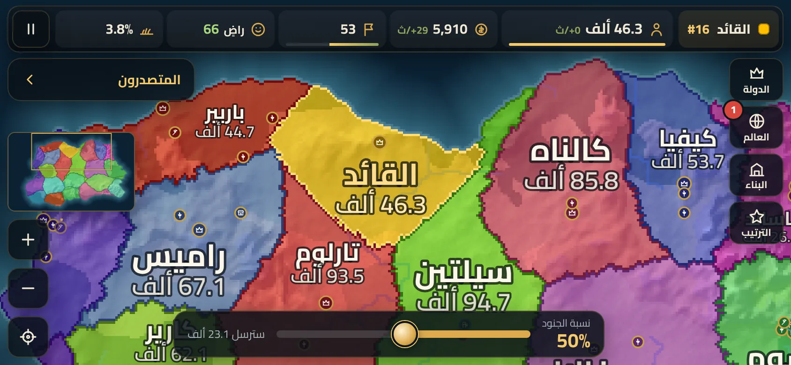
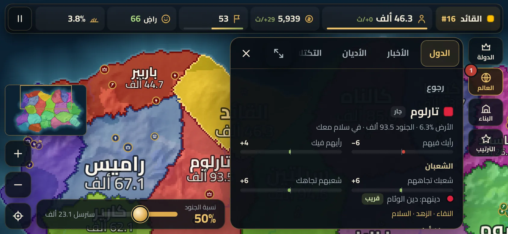

<div dir="rtl">

# الحرب العظمى

لعبة استراتيجية للأندرويد على خريطة من مربعات: توسّع في الأرض المحايدة، وتحالف، وحارب جيرانك، وأدِر دولتك حتى تحكم الخريطة كلها.

## [نزّل اللعبة للأندرويد](https://github.com/youssefshawwaf-coder/great-war-download/raw/main/great-war.apk)

الإصدار 0.11.0 · الحجم 4.3 ميغابايت · أندرويد 7 أو أحدث



## التثبيت

1. اضغط «نزّل اللعبة للأندرويد» وانتظر حتى يكتمل التنزيل.
2. افتح الملف `great-war.apk` من الإشعارات أو من مجلد التنزيلات.
3. إذا قال أندرويد إن التثبيت من هذا المصدر غير مسموح، فاضغط «الإعدادات» واسمح للمتصفح بالتثبيت، ثم ارجع واضغط «تثبيت».
4. افتح «الحرب العظمى» من قائمة التطبيقات.

اللعبة ليست على Google Play بعد، لذلك يسألك أندرويد قبل التثبيت، وقد يعرض Play Protect تنبيهًا بأن المطوّر غير معروف لديه. والنسخ الجديدة تُثبَّت فوق القديمة.

## في اللعبة

- أربع جولات: سريعة تنتهي في دقائق، ومتوسطة، وبطيئة، وبطيئة جدًا تمتد ساعات.
- اختر نسبة جنودك، واضغط على الأرض المحايدة لتتوسع، أو على جارك لتهاجمه.
- تحالفات ومعاهدات وتكتلات ودول تابعة، وجنود دعم ترسلهم إلى حليفك حين يُهاجَم ثم يعودون إليك.
- اقتصاد وضرائب، وشعوب تطالب حكامها وتثور، وأديان تؤسسها الدول وتنشرها.
- ثمانية وثلاثون مبنى وأربع عجائب، وخرائط حتى 500 دولة.
- تعمل بلا إنترنت، بالعربية والإنجليزية.



## بصمة الملف

بصمة `great-war.apk` بخوارزمية SHA-256، لمن يريد التأكد أن الملف لم يتغير:

</div>

```
2cabe69bd4cfa0ac8d4e2b1261eaec0b9dd0fa2bbfc9d44b0bacdc2c76ed0483
```

<div dir="rtl">

هذا المستودع لا يحوي إلا صفحة التنزيل. الخط Cairo برخصة [SIL Open Font License](fonts/OFL.txt).

</div>
